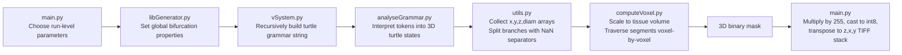
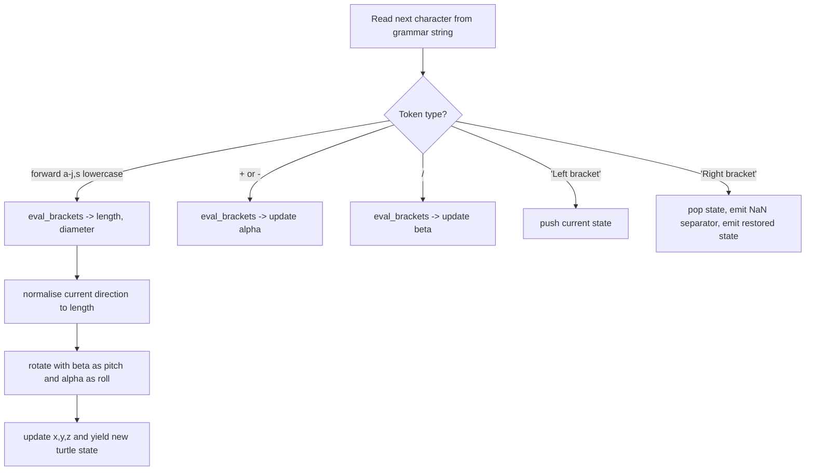
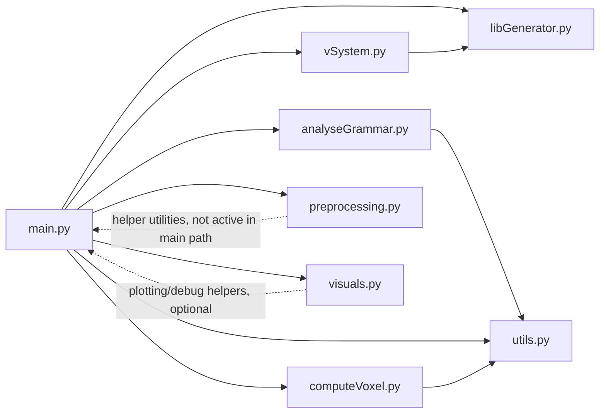

# ALGORITHM.md

## Purpose

This document explains how the current `V-System` repository turns stochastic vascular grammar rules into a saved 3D vessel volume. It is intentionally code-oriented: the goal is to describe the implementation that exists in this repository, not just the paper-level idea from the README.

The overall structure is consistent with the three-stage view used in the project documentation:

1. Grammar Generation
2. Geometry Construction
3. Voxelization

## High-Level Pipeline



## Inputs, Intermediate Forms, and Output

### Inputs

- A run count `n` in `main.py`.
- A sampled root diameter `d0`.
- A sampled recursion depth `niter`.
- A dictionary of tunable grammar properties:
  - `k`
  - `epsilon`
  - `randmarg`
  - `sigma`
  - `stochparams`
  - `tortuosity_enabled`
  - `tortuosity_min_depth`
  - `tortuosity_prob_base`
  - `tortuosity_prob_slope`
  - `tortuosity_angle_base`
  - `tortuosity_angle_slope`
  - `tortuosity_angle_cap`
- A target tissue volume shape `tissue_volume`.
- Collision-control properties:
  - `collision_clearance`
  - `collision_retry_count`
  - `voxel_overlap_tolerance`

### Intermediate representations

- A grammar string such as `f(...)[+(...)/(...)]...` from `vSystem.py`.
- A stream of turtle states from `analyseGrammar.py`:
  - `(x, y, z, alpha, beta, diam, lseg, dx, dy, dz)`
- A `4 x N` point array from `utils.bezier_interpolation()`:
  - row 0: `x`
  - row 1: `y`
  - row 2: `z`
  - row 3: `diam`
  - `NaN` columns act as branch separators
- A discretized `4 x N` array in voxel coordinates inside `computeVoxel.process_network()`
- A 3D integer image stack `img_stack` used as the vessel mask

### Output object

- Final output is a 3D binary vessel volume converted to `255/0` and saved as a TIFF stack.
- `main.py` transposes the array from `(x, y, z)` to `(z, x, y)` before saving.

## Stage 1: Grammar Generation

### What happens

`main.py` creates one network per loop iteration. For each network it samples both structural and stochastic parameters, registers them through `setProperties()`, then calls `F(niter, d0)` as the primary grammar entry point.

The grammar is not stored as a symbolic tree object. Instead, the system directly builds a single turtle program string containing:

- forward commands: `f(...)`
- orientation changes: `+(...)` and `-(...)` change `alpha` (roll-like left/right steering), while `/(...)` changes `beta` (pitch-like out-of-plane tilt)
- branch stack markers: `[` and `]`
- grouping braces from stem generators: `{` and `}`

In the current interpreter, these orientation tokens do not move the turtle by themselves. They only update the angles stored in the active state, and the next forward token uses those updated angles when `rotate(...)` computes the next segment direction.

### Tunable parameters

The main user-visible tunables in the current implementation are:

- `n`: number of separate vascular volumes to generate
- `d0_mean`, `d0_std`: Gaussian sampling of the initial trunk diameter
- `tissue_volume`: target voxel volume size
- `k`: Murray-law-like exponent used in daughter diameter splitting
- `epsilon`: proportional relationship between diameter and branch length
- `randmarg`: random perturbation on branch length
- `sigma`: spread used when sampling a stochastic daughter diameter
- `stochparams`: enables stochastic daughter diameter sampling
- `niter`: recursion depth, sampled per object
- `collision_clearance`: extra radius margin used only when geometry-stage collision checks are enabled
- `collision_retry_count`: retry budget for alternate child orientations; negative values keep geometry avoidance disabled so the legacy turtle path is preserved
- `voxel_overlap_tolerance`: allowed voxel overlap count during rasterization; negative values keep the fallback rejection disabled so the legacy voxel write path is preserved
- `tortuosity_enabled`: master switch for depth-biased stem curvature
- `tortuosity_min_depth`: minimum recursive branch depth eligible for tortuosity
- `tortuosity_prob_base`: probability of curving a child stem at `tortuosity_min_depth`
- `tortuosity_prob_slope`: probability increase per additional depth level
- `tortuosity_angle_base`: total steering angle scheduled onto an eligible stem at `tortuosity_min_depth`
- `tortuosity_angle_slope`: angle increase per additional depth level
- `tortuosity_angle_cap`: hard upper bound on the total scheduled stem curvature

### Core functions in `vSystem.py`

The current implementation uses several mutually recursive string builders:

- `F(n, d0)`: main recursive tree constructor used by `main.py`
  - Builds a stem with `S(...)`
  - Creates two bracketed daughter branches using `+` and `-`
  - Applies an extra `/` tilt per daughter
  - Tracks the current recursive branch depth and passes `depth + 1` to child `F(...)` calls
- `S(n, d0)`: randomly chooses one of two stem patterns
  - `S1(...)`
  - `S2(...)`
- `S1(n, d0)` and `S2(n, d0)`:
  - Create a fan-like sequence of forward segments via repeated `D(...)`
  - Alternate sign on rotation commands to produce asymmetric meandering
  - Occasionally apply growth/decay multipliers to diameters
  - Apply an optional depth-biased steering schedule only when the current stem belongs to an eligible child branch
- `D(n, d0)`:
  - Emits a single forward token `f(length, diameter)`
  - Uses `calParam()` and `calBifurcation()` to derive segment length

### Recursion depth and child-stem tortuosity

Feature 2 keeps the existing recursive grammar flow and only threads one extra piece of state through it: the current branch depth.

- The root `F(...)` call starts at `depth = 0`.
- Each daughter branch is generated by a recursive `F(...)` call with `depth + 1`.
- The stem built at the top of each `F(...)` call therefore inherits the depth of that branch.
- Tortuosity is applied only to those stems, not to the trunk coordinates directly and not by editing turtle points after the fact.

This keeps the proximal trunk unaffected because the root stem is depth `0`, and any branch with depth less than `tortuosity_min_depth` returns to the legacy stem construction path without consuming extra tortuosity randomness.

### Tortuosity probability and angle schedule

For an eligible child stem, `vSystem.py` computes:

- `depth_offset = depth - tortuosity_min_depth`
- `prob = tortuosity_prob_base + tortuosity_prob_slope * depth_offset`
- `prob` is clipped to `[0, 1]`

If that stem is selected, the total scheduled curvature is:

- `angle = tortuosity_angle_base + tortuosity_angle_slope * depth_offset`
- `angle` is clipped above by `tortuosity_angle_cap`
- Negative angles are clamped back to `0`

The implementation therefore makes deeper branches more likely to curve and, when they do curve, allows them to accumulate a larger total heading drift while still respecting a hard cap.

### Grammar-level steering sequence

Tortuosity is represented entirely in the grammar emitted by `vSystem.py`.

- `S1(...)` and `S2(...)` still create five forward stem segments.
- For a selected child stem, the total curvature angle is split across the four inter-segment turns of that stem.
- Each steering increment is a valid `+(...)` or `-(...)` grammar token.
- Mild random weighting is applied before normalization so the drift stays smooth rather than perfectly uniform, but the signed increments still sum to the scheduled total angle.
- `analyseGrammar.py` consumes those tokens normally, so the turtle path bends through the existing grammar-to-state interpreter.

Because the turns are distributed across successive forward steps, curvature accumulates gradually along the stem instead of appearing as a single sharp bend.

Other generators exist (`A`, `B`, `R`, `I`, `G`) but `main.py` currently imports only `F` for the active workflow.

### Parameter derivation

`libGenerator.py` provides the numerical rules behind string generation:

- `setProperties(properties)` stores the active globals
- `calBifurcation(d0)` computes:
  - parent diameter echo `d0`
  - daughter diameters `d1`, `d2`
  - daughter angles `th1`, `th2`
  - branch length proxy `co`
- `getLength(d0)` computes the stochastic branch length range from `epsilon` and `randmarg`
- `calParam(text, params)` resolves expressions like `co/5` before serializing them into `f(...)`

### Grammar generation loop

```text
sample d0, niter, properties
setProperties(properties)
grammar = F(niter, d0)

F:
  build stem S(...)
  recurse left branch inside [...]
  recurse right branch inside [...]
  stop when n == 0
```

### Decision points and stopping conditions

- `S()` flips between `S1` and `S2` using a random margin threshold.
- `S1` and `S2` sometimes apply temporary growth/decay multipliers.
- Every recursive grammar function stops when `n == 0`.
- `F` is the practical stopping controller for the full object because its recursion depth is `niter`.

## Stage 2: Geometry Construction

### What happens

The grammar string is interpreted by `analyseGrammar.branching_turtle_to_coords()`, which behaves like a 3D turtle with a stack for branching. It yields a sequence of states instead of building one large graph object.

The turtle state contains:

- current point: `x, y, z`
- orientation: `alpha, beta` (`alpha` is the accumulated roll-like turn used by `+`/`-`, `beta` is the accumulated pitch-like tilt used by `/`)
- local diameter: `diam`
- most recent segment length: `lseg`
- most recent displacement: `dx, dy, dz`

### Token execution workflow



### How the functions in `analyseGrammar.py` work

- `branching_turtle_to_coords(turtle_program, d0, ...)`
  - Initializes a fixed starting state near `(0.1, 0.1, 1.0)`
  - Walks the grammar character-by-character
  - Uses `eval_brackets()` to parse numeric payloads after tokens
  - Applies orientation changes and branch push/pop behavior
  - Emits all states as a generator
- `eval_brackets(index, turtle)`
  - Parses one or two numbers inside token parentheses
  - Returns `(value1, value2)` where the second value is typically diameter or `0.0`
- `posneg()`, `randomposneg()`, `raddist()`, `proximity()`
  - Mostly helper or experimental functions
  - `proximity()` is currently not active in the main path because its call is commented out

### Spatial constraints

The current codebase applies spatial constraints in a lightweight, implementation-specific way:

1. Orientation-constrained growth
   - Segment motion is always derived by rotating a normalized direction vector.
   - This constrains growth to incremental local heading changes rather than arbitrary coordinate jumps.
2. Branch restoration with stack semantics
   - `[` stores a turtle state and `]` restores it.
   - This enforces tree branching from a prior node instead of free-floating segment starts.
3. Implicit branch separation using `NaN`
   - When `]` is processed, the interpreter emits a `NaN` state, then the restored state.
   - Downstream stages use this to avoid connecting unrelated branch segments.
4. Voxel-space boundary clipping
   - `computeVoxel.transversal()` checks voxel indices before writing.
   - `check_boundary()` clears all outer faces of the final volume.
5. Margin-based spatial scaling
   - `process_network()` scales continuous coordinates into the requested volume using min/max bounds expanded by `10%`.
   - This reduces immediate contact with the volume edges.

Feature 1 adds two more constraints without changing the pipeline order:

6. Geometry-stage occupancy checking
   - `branching_turtle_to_coords()` now optionally maintains a plain Python list of accepted vessel segments for the current tree.
   - Before a lowercase forward token is committed, the interpreter builds the proposed segment from:
     - current start point
     - rotated end point
     - effective radius `0.5 * diam + collision_clearance`
   - The proposed segment is compared against every accepted segment using a conservative capsule-style overlap test based on shortest segment-to-segment distance.
7. Junction exemption and retry-with-perturbation
   - Collision checks are skipped when the proposed segment starts inside the parent bifurcation neighbourhood.
   - The current implementation defines that neighbourhood as `parent_radius * 2.0`.
   - If a non-exempt segment collides, the interpreter retries up to `collision_retry_count` times by perturbing `alpha` and `beta` around the original child heading.
   - Perturbations widen with each retry.
   - If every retry fails, the current branch is terminated early and the interpreter skips the remaining grammar inside that branch until the matching `]`.

There is also a not-currently-active notion of radial containment in `proximity()` and `raddist()`, but it does not participate in the executed pipeline.

### Scaling and applying volumetric math

Before voxel traversal, the continuous coordinate cloud is normalized into the requested tissue volume:

- `process_network()` computes `dmin` and `dmax` across all non-NaN rows
- both are multiplied by `1.1`, effectively padding the bounding box
- `discretisation()` maps each point into integer voxel coordinates with:
  - scaled `x`
  - scaled `y`
  - scaled `z`
  - unchanged `diam`

This is the key bridge between geometry space and voxel space.

### Branch reshaping and intermediate arrays

`utils.bezier_interpolation()` currently acts more like a branch organizer than a full smoothing stage:

- It consumes the generator output from `branching_turtle_to_coords()`
- Extracts only `x, y, z, diam`
- Uses `NaN` rows to split branch segments
- Deduplicates points within each vessel fragment
- Groups points in windows of six control points
- Appends those control-point chunks to `newNodes`

Important implementation detail:

- `interpolate_this()` exists and can evaluate a Bezier curve, but it is commented out in the active path.
- So the present implementation mostly forwards grouped control points rather than dense interpolated curves.

## Stage 3: Voxelization

### What happens

`computeVoxel.process_network()` converts the organized point stream into a 3D voxel mask. It does this by connecting consecutive valid points with a line traversal and thickening that traversal according to the local diameter.

Feature 1 also adds an optional voxel-space fallback rejection stage:

- The output mask now starts from zeros before any segment is processed.
- For each candidate segment, `process_network()` first computes the full voxel set the segment would occupy.
- If voxel overlap rejection is enabled, that voxel set is compared against already accepted voxels.
- Overlaps inside a local junction tolerance region around the segment start are ignored.
- If the remaining overlap count is greater than `voxel_overlap_tolerance`, the segment is skipped and a warning is printed instead of raising.

### Voxelization workflow

1. Compute `dmin` and `dmax` from the point cloud
2. Discretize all valid coordinates into volume indices
3. Preserve `NaN` separators during array rebuild
4. Walk through adjacent point pairs
5. Skip any pair crossing a `NaN` separator
6. Compute mean diameter of each valid pair
7. Run `transversal(...)` to visit voxels along the segment
8. For each traversal step, call `diamVoxels(...)` to stamp a local circular cross-section
9. Zero the outer boundary with `check_boundary(...)`

With Feature 1 enabled, step 7 is preceded by a voxel-set prediction and overlap test; the actual write happens only for accepted segments.

### Single-object iterative skeleton loop

```mermaid
flowchart TD
    A[Sample one object in main.py] --> B[Call F(niter, d0)]
    B --> C{n > 0?}
    C -->|yes| D[Emit stem tokens via S/S1/S2 and recurse into daughters]
    C -->|no| E[Return terminal symbol]
    D --> F[branching_turtle_to_coords reads tokens sequentially]
    F --> G{Current token?}
    G -->|forward| H[Advance turtle and yield state]
    G -->|branch close| I[Emit NaN gap and restore branch state]
    H --> J[bezier_interpolation groups branch points]
    I --> J
    J --> K{Another valid point pair?}
    K -->|yes| L[Discretize pair and voxel-traverse segment]
    K -->|no| M[Boundary cleanup and save volume]
```

### Decision points

- Whether a point pair is connected:
  - Only if neither column is `NaN`
- Whether a proposed turtle segment is accepted:
  - immediately when collision avoidance is disabled
  - immediately when it lies inside the junction exemption neighbourhood
  - after the first collision-free retry, if retries are enabled
  - otherwise the active branch terminates early
- Segment radius:
  - `r = floor(0.5 * diam)`
- Whether a rasterized segment is written:
  - always when voxel overlap rejection is disabled
  - only if overlap outside the local junction tolerance is `<= voxel_overlap_tolerance` when enabled
- Which axis advances during traversal:
  - chosen by the voxel traversal error terms in `transversal()`
- Which voxels are filled around the centerline:
  - determined by `diamVoxels()` and the current principal axis

### Stopping conditions

- Point-pair processing stops at `newarray.shape[1] - 1`
- Individual segments stop when traversal step count `n` reaches zero
- A branch also stops early when a geometry-collision proposal and all retry proposals are rejected
- The full object ends once all grammar tokens have been interpreted and all valid point pairs have been rasterized

## Default-Preserving Behavior

Feature 1 is wired through the existing properties dictionary to turn off this feature and restore the default settings used in `main.py`:

- `collision_clearance` sets to `0.0`
- `collision_retry_count` sets to a negative sentinel `-1`, which leaves geometry avoidance disabled
- `voxel_overlap_tolerance` sets to a negative sentinel `-1`, which leaves voxel overlap rejection disabled

Under those defaults, the grammar generation stage is unchanged, the turtle interpreter follows the legacy forward-step path, and the voxelizer writes the same vessel support as before while now starting from a deterministic zero-filled mask.

Feature 2 is also default-preserving:

- `tortuosity_enabled` defaults to `False`
- `tortuosity_prob_base` and `tortuosity_prob_slope` default to `0.0`
- `tortuosity_angle_base` and `tortuosity_angle_slope` default to `0.0`
- `tortuosity_angle_cap` defaults to `30.0` but is inactive while the feature is off

With those defaults, stem grammar generation remains byte-for-byte compatible with the legacy implementation because no extra steering tokens are inserted and no additional tortuosity random draws are consumed.

## Repository Structure Map



### Module-by-module responsibilities

#### `main.py`

- Top-level orchestration script
- Samples random parameters for each output
- Registers grammar properties
- Calls the three major stages in order:
  - `F(...)`
  - `branching_turtle_to_coords(...)`
  - `process_network(...)`
- Converts binary volume to `int8`
- Saves the final TIFF stack

#### `preprocessing.py`

- Provides 3D resize helpers:
  - `resize_stacks(...)`
  - `resize_volume(...)`
- Not used in the current `main.py` execution path
- Useful for post-processing or adapting generated volumes to other target sizes

#### `analyseGrammar.py`

- Interprets the grammar string as a 3D turtle program
- Maintains branch state stack
- Emits `NaN` separators between disconnected branch paths
- Handles token payload parsing

#### `computeVoxel.py`

- Converts continuous point data into voxel coordinates
- Traverses each segment through the volume
- Expands the centerline according to local diameter
- Applies boundary cleanup

#### `libGenerator.py`

- Stores active growth properties globally
- Computes bifurcation geometry and branch lengths
- Supplies numeric values embedded into grammar tokens

#### `utils.py`

- Rotation math used by the turtle interpreter
- Point-array assembly helpers
- Branch grouping through `bezier_interpolation()`
- Additional utility functions for noise, normalization, loading, and wrapping

#### `visuals.py`

- Optional plotting and coordinate-printing helpers
- Not required for generation, but useful for debugging geometry before voxelization

#### `vSystem.py`

- Recursive grammar constructors
- Defines the stochastic production logic of the vascular tree
- Encodes branching structure, turning angles, and local segment diameters into the turtle string

## Key Constants and Thresholds

- `k = 3`
  - exponent used in daughter-diameter calculation
- `epsilon`
  - controls expected branch length as `d0 * epsilon`
- `randmarg`
  - length perturbation range around `d0 * epsilon`
- `sigma = 5`
  - spread of daughter diameter sampling
- `niter in [6, 14]`
  - recursion depth sampled per generated object
- rotation samples near `22.5` to `27.5` degrees
  - used repeatedly for out-of-plane or side branching
- `tortuosity_min_depth = 2`
  - keeps the proximal trunk and first recursive branch level on the legacy path by default
- `tortuosity_angle_cap = 30.0`
  - limits total scheduled curvature per eligible child stem
- `10%` min/max expansion in `process_network()`
  - keeps geometry away from the volume boundary
- `r = floor(diam / 2)`
  - voxel radius used for local thickening

## Important Assumptions

- The main grammar entry point is `F(...)`; other generators are secondary or experimental.
- The saved volume is intended to be binary vessel occupancy, not a probabilistic or labeled mask.
- Geometry points are assumed to be safely normalizable into a finite bounding box.
- `NaN` columns are the only branch-discontinuity marker used between geometry and voxelization.
- The execution path assumes stochastic behavior; identical runs are not guaranteed without fixed seeds.

## Current Limitations and Implementation Caveats

- `preprocessing.py` and `visuals.py` are imported by `main.py` but not used in the default generation path.
- `bezier_interpolation()` does not currently perform active Bezier smoothing in the main path because `interpolate_this()` is commented out.
- `process_network()` creates `img_stack` with `np.empty(...)`, so the array is not explicitly zero-initialized before drawing.
- The geometry interpreter reads the grammar character-by-character, so the token model is simple but somewhat brittle.
- `eval_brackets()` uses `eval(...)` on parsed text, which works for the current grammar format but is not a hardened parser.
- `transversal()` computes `mx, my, mz` but does not use them afterward.
- `check_boundary()` forcibly clears the outermost voxel layer, which may remove valid structure touching the edge.
- The output cast is `int8` after multiplying by `255`; that can represent signed values rather than the more typical `uint8`.
- There is no explicit seed management, CLI, or object metadata file in the current script.
- No `LOG.md` was present in this repository during documentation review, so caveats here are inferred directly from the code.

## Developer-Oriented Summary

For a new developer, the simplest mental model is:

1. `main.py` samples parameters and asks `vSystem.py` to write a vascular sentence.
2. `analyseGrammar.py` reads that sentence as a 3D turtle and emits branch-separated points.
3. `utils.py` compacts those points into a `(x, y, z, diam)` stream.
4. `computeVoxel.py` scales that stream into voxel space and paints each segment into a 3D array.
5. `main.py` saves the result as a TIFF volume.

The implementation is therefore not a graph optimizer or iterative centerline extractor. It is a forward generative pipeline: stochastic grammar -> turtle geometry -> voxel mask.
